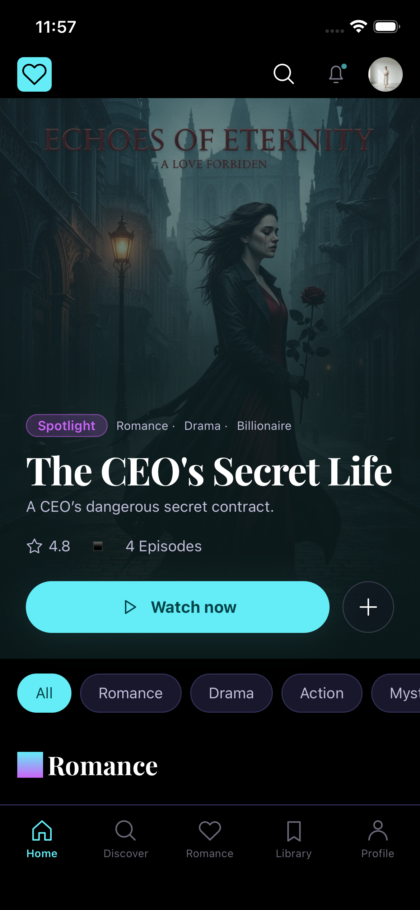
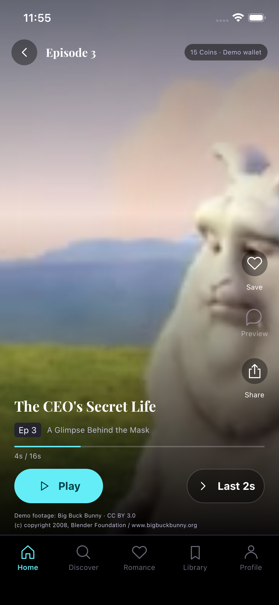
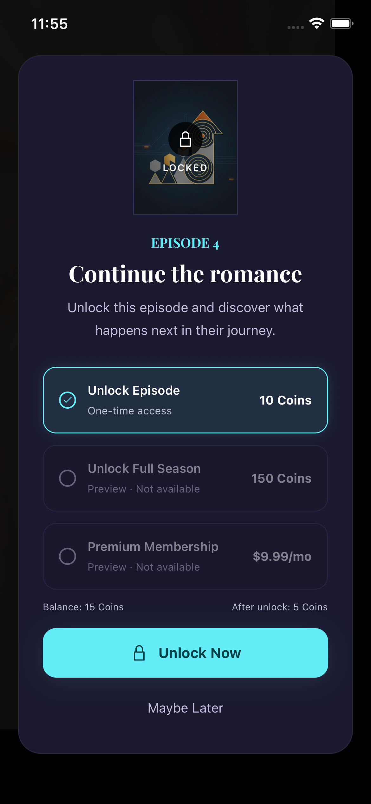

# DramaFlash

A React Native / Expo demo for the TargetVideo assignment, Option A. Follow a
story from discovery to a playable cliffhanger, then buy its continuation with
simulated Coins. No account, payment service or external API is required.

## Try it

1. On Home, choose **Reset demo**, then **Watch now**.
2. Choose **Watch demo cliffhanger (Ep 3)**. Play the bundled video, or use
   **Last 2s** to reach its real end sooner.
3. At **To be continued…**, choose **Unlock Episode 4**.
4. **Maybe Later** returns without spending. **Unlock Now** commits the purchase,
   changes the balance from **15 to 5**, and opens Episode 4.
5. Restart the app: the purchase, watchlist and playback checkpoints remain.
   **Reset demo** restores 15 Coins and clears purchases, watchlist and progress.

Episodes 1–3 are free. Episode 4 costs 10 Coins. There are three different,
labelled sample clips: 16, 12 and 14 seconds. They do not depict the fictional
series. Locked deep links never create a video player.

**Demo settings** on Home lets you select normal, slow or offline transport,
and arm a failure for the next unlock:

- **Fail next unlock:** fails before committing; retry can purchase normally.
- **Lose next unlock response:** commits, then loses the reply. **Refresh offer**
  recovers the purchase without another debit.
- **Invalid next unlock response:** commits, then returns an invalid payload.
  Runtime validation rejects it; refreshing retrieves the durable result.

The application, catalogue, source code and tests use English only. Reset restores
the profile and normal connection. Debug network mode and armed failures do not
survive an app restart.

## Run

Use Node **24.22.0** and npm:

```sh
nvm install
nvm use
npm ci
npm start
```

Open the project in an **Expo SDK 58 compatible Expo Go** app. iOS requires
macOS and Xcode; Android requires a device or emulator. Supported platforms are
**iOS and Android**.

Media, artwork, fonts and language data are bundled. Development still needs
Metro for the JavaScript bundle. If localhost resolves to IPv6 first:

```sh
NODE_OPTIONS=--dns-result-order=ipv4first npm start -- --go --localhost --port 8081
```

## Architecture

| Location                        | Responsibility                                                                                                             |
| ------------------------------- | -------------------------------------------------------------------------------------------------------------------------- |
| `app/`                          | Thin Expo Router entries; `[episodeId]` / `[seriesId]` are dynamic route parameters.                                       |
| `src/core/domain/`              | Zod contracts and inferred types, access rules, coin quotes, immutable transactions, profile validation.                   |
| `src/core/infrastructure/mock/` | Async mock API, localized catalogue fixtures, transport delay/faults and serialized durable commands.                      |
| `src/core/infrastructure/`      | Storage adapters and ordered profile snapshot writes.                                                                      |
| `src/core/application/`         | TanStack Query runtime, query keys/options, mutations, hydration, foreground refresh, Zustand UI store and route builders. |
| `src/core/localization/`        | English messages, typed interpolation, plural and number formatting.                                                       |
| `src/features/`                 | Home, series, player and unlock screens and feature components.                                                            |
| `src/ui/`                       | Shared components, feedback, artwork and reduced-motion-aware entry animation.                                             |

TanStack Query owns catalogue, profile and offer data, loading/error states and
mutations. Zustand owns transient connection simulation and toast state.
`DemoProvider` supplies a stable API/QueryClient runtime through Context.
`useDemo` exposes the profile, catalogue and commands to feature components.

`catalogue.ts` contains domain types and lookup helpers. Content, descriptions,
prices and preview plans come from the mock API fixture rather than screen
constants. The transport takes 350 ms normally and 1,750 ms in slow mode. Its
request/response boundary validates JSON with Zod. Catalogue content and offers
are exposed through query options; profile commands use serialized mutations.

Queries support cancellation, stale/cache limits and foreground refresh. Initial
hydration gates protected screens. A background refresh keeps validated cached
data and reports failures through the shared error policy. Routes are built centrally
in `routes.ts`; features validate the actual IDs against the loaded catalogue.
Components have individual files; `components.tsx` exports shared UI components.
ESLint prohibits functions, objects, arrays and JSX created in render scope as
props. Callbacks use `useCallback`, dynamic prop values use `useMemo`, and static
values live at module scope. Reusable buttons, cards, rows and player identity
use `memo` with stable props.

## Purchase and persistence guarantees

The mock API owns commands. It validates the episode, current price, balance,
exact entitlement kind/source, session generation and idempotency key. Commands
are serialized, and purchase access is never granted optimistically. The offer
and cancellation controls are disabled during confirmation. A committed purchase
can be replayed after a lost response without another debit. New grants record
the paid price, so later price changes do not invalidate historical purchases.
Reset advances the generation, rejecting stale commands; cancelled hydration and
older cache snapshots cannot restore access after reset.

Profiles use **Expo SecureStore** on iOS and Android, including wallet receipts,
watchlist, playback checkpoints, revision and reset generation. The profile schema
requires all fields and rejects unsupported formats. UI state and the Query cache
live in memory. Neither Query cache nor a toast can manufacture an entitlement.
Profile validation rejects malformed/inconsistent balances, unknown or duplicate
purchases and invalid progress. Storage failure leaves access locked and offers
visible recovery; it does not silently replace the profile with fresh funds.

Positions are checkpointed on pause, backgrounding, route blur and cleanup;
pause reads the current media clock rather than waiting for the next progress
event. Completed episodes restart from the beginning. `EpisodeProgress` listens
to media events separately, avoiding video-surface redraws for every tick.
Backgrounding and route blur pause playback; returning requires explicit Play.
Duplicate, paused, background and disposed-player completion events are ignored.
Sharing handles cancellation, failure, pending duplicates and late callbacks.

These are **local demo guarantees**, not a payment security boundary. A modified
client can forge a consistent profile or extract bundled media. A production
system needs server-owned balances/receipts, verified store transactions,
authentication and authorized media delivery. A forced process kill before an
asynchronous write completes can lose the latest checkpoint. Multi-device transaction coordination is not implemented.

## Components and localization

| Component        | Responsibility and use                                                                                                                                                                                                                     |
| ---------------- | ------------------------------------------------------------------------------------------------------------------------------------------------------------------------------------------------------------------------------------------ |
| `DemoSettings`   | Expand **Demo settings** on Home to select normal/slow/offline transport or arm one unlock failure. These controls exercise recovery scenarios without changing business rules.                                                            |
| `PlayerIdentity` | Displays the series title, episode number and episode name over the video or cliffhanger. It receives validated episode/series props and is memoized independently of media progress.                                                      |
| `ToastHost`      | Mounted once by `DemoBootstrap`; displays shared API/share errors from the UI store, announces them to accessibility services, and dismisses them after five seconds or a close action. Screens retain their actionable recovery controls. |

The supported locale is English. `useI18n` supplies typed message keys and required
interpolation parameters, plus number and plural formatting. FormatJS packages
supply **ECMA-402 Intl polyfills** for Hermes; they are not the translation
framework. See the [FormatJS Hermes guidance](https://formatjs.github.io/docs/polyfills/intl-pluralrules/).
`react-i18next` is a valid React Native integration for i18next, with namespaces,
translation loading and language switching. This application uses one bundled
typed catalogue; it has no dynamic translation loading or language selector.
i18next also [requires Intl.PluralRules support](https://www.i18next.com/translation-function/plurals)
for plural formatting.

## Verification

```sh
npm run verify
npm run qa
```

`verify` runs the English-only source/file-name check, strict TypeScript, ESLint
(including SonarJS recommended production rules and JSX prop rules), Prettier and
Jest coverage. ESLint allows **zero warnings**. Coverage includes every authored
production TS/TSX file in `app/` and `src/`, including routes; only tests and type
declarations are excluded. All four global thresholds are **100%**.

GitHub Actions runs `npm ci` and `npm run verify` on pull requests and pushes to
`main`. The workflow uses the Node version in `.nvmrc` and caches npm downloads.

Jest/RNTL exercise domain operations, runtime schemas, routes and query mutations.
Native media/storage boundaries are mocked. Tests cover access denial, price
changes, duplicate/lost confirmations, stale generation and hydration races,
persistence failures, lifecycle interruptions, error recovery, English formatting,
reduced motion, share cancellation and cleanup.

`qa` runs `verify` and the **full local SonarQube analysis**. Install and start
Docker first. No external SonarQube account or server is required. The first run
pulls pinned SonarQube Community and official SonarScanner images, starts the
server at `http://127.0.0.1:9000`, and provisions a local token. Docker Desktop
provides `host.docker.internal` for scanner-to-server communication. The scanner
image runs as Linux amd64, including on Apple Silicon through Docker emulation.

```sh
# Repeat the full Sonar analysis against current coverage/lcov.info:
npm run sonar:local

# Release local server resources after QA:
docker stop dramaflash-sonarqube
```

The runner waits for the submitted analysis task, reads open issues at every
severity (including security findings), analysis warnings, quality-gate state and
coverage/duplication metrics. Each finding is printed as a warning; **any warning
fails QA**. Scanner or server failure also fails QA. JSON evidence is saved to
`reports/sonar/report.json`. Local credentials are stored with mode 0600 in the
ignored `reports/sonar/credentials.json`; neither file belongs in Git. The pinned
Community version exposes security findings through its issues API. These checks
cover the configured Sonar rules; they do not certify payment security or replace
device testing and dependency auditing.

Native end-to-end checks use Maestro with a real Expo Go player and SecureStore:

```sh
# Start Metro on localhost:8081; boot an iOS simulator with Expo Go.
maestro --udid <simulator-udid> test \
  -e 'EXPO_URL=exp://127.0.0.1:8081?__expo_disable_fab=1&__expo_disable_auto_launch=1&__expo_disable_onboarding=1' \
  e2e/native/journey.yaml
```

The journey exercises native playback, pause/resume/end, cancellation, double
confirmation, persisted access after stopping Expo Go, navigation and reset.
Android, physical devices, release builds and manual screen-reader testing have
not been verified.

Expo versions are pinned. The dependency audit reports tooling chains involving
`braces`, `node-forge` and `sprintf-js` without published fixes. The `uuid` override
is scoped to `xcode`.

## Screenshots and credits

Actual iPhone 17e / iOS 26.4 captures from the successful native journey on
October 22, 2026:

| Home                                                                     | Player                                                                       | Unlock                                                                     |
| ------------------------------------------------------------------------ | ---------------------------------------------------------------------------- | -------------------------------------------------------------------------- |
|  |  |  |

Individual illustrations supplied with the assignment are used with permission.
The UI is implemented with React Native components. Artwork totals 1.76 MB.
Playfair Display Bold is distributed under SIL OFL 1.1; `assets/fonts/OFL.txt`
is the required font license notice. The three video excerpts are shortened,
re-encoded **Big Buck Bunny**, licensed **CC BY 3.0**:

(c) copyright 2008, Blender Foundation / www.bigbuckbunny.org

See [asset sources, licenses and modifications](assets/README.md). Unsupported
destinations, subscriptions and other purchase options remain labelled previews.
